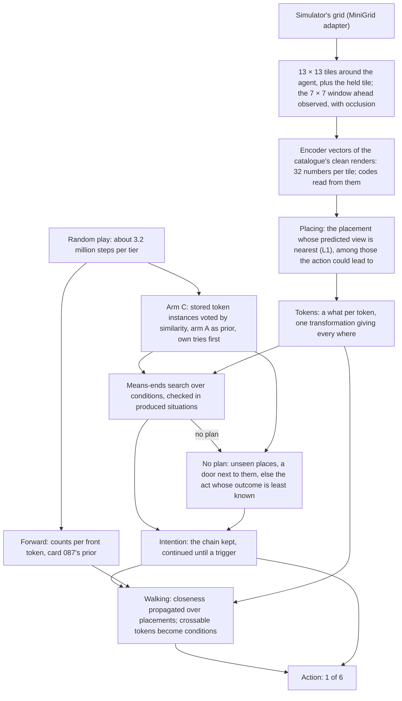

# Architecture

Version 27 ([card 101](experiments/101-one-rule-with-no-plan/card.md),
2026-10-10) has one rule for acting when the planner finds no plan and
nothing unseen is left to walk to. It replaces card 095.7's inform and
card 072's trying:
- The agent acts on the (action, token, hand) whose outcome arm C knows
  least, counting this episode's own tries. The score is
  U = 1 − max(P(no change), P(change) · c). P is arm C's prediction that
  the token changes. c is how sure arm C's store is of what the token
  becomes (card 095.7's measure).
- The choice is ranked by U / (1 + walking steps), and becomes the
  intention's condition. When the agent reconsiders, the held act comes
  first while it is not made and still uncertain.
- Once the hand and facing are right, the act is made whatever arm C
  predicts. Being made is its success.
- Results:
  - tiers 1 and 2 identical to version 26;
  - tier 3 30/30 in 118.8 steps (26: 128.9);
  - fresh tier 3 seeds 100/100 (26: 98/100), with no fallback loop.
    Seeds both versions win take 146.1 steps against 141.2.

Version 26 ([card 100](experiments/100-one-held-intention/card.md),
2026-10-10) keeps choices between steps in one place, the intention:
- Card 051's kept achievers and card 060's kept door are gone; the
  intention already holds both between triggers.
- Where card 074.1 breaks a tie among an achiever's needs, the intention's
  chain gives the need it pursued first. That is the chain held now, or
  the one just dropped when the agent deliberates.
- Results:
  - tier 1 200/200 and tier 2 100/100, each episode with version 25's
    steps;
  - tier 3 30/30 in 128.9 steps;
  - fresh tier 3 seeds 98/100 in 141.2 steps (version 25: 99/100 in
    144.5; no different).
- The seed it loses had been won through card 074.1's memory of a tie
  resolved earlier in the episode, outside the last chain.

Version 25 ([card 099](experiments/099-version-24-without-dead-parts/card.md),
2026-10-10) is version 24 without the parts it no longer read:
- Arm C alone predicts pick up, drop and toggle. It fits on its own store
  how much this episode's tries count.
- No longer built:
  - version 20's recall for those actions (card 042's two levels, card
    049's admitted conditions, card 050's α, card 051's index, card 047's
    situations);
  - card 091's router;
  - card 085's fits;
  - card 074.1's split.
- Every episode of tiers 1–3 and of the 100 fresh tier 3 seeds is the same
  as version 24's.
- Tier 3's model setup takes 10 s (version 24: 118 s), and each step takes
  0.012 s (0.034).
- An audit of version 24's code (2026-10-10) found the MiniGrid-specific
  assumptions now listed under "Built-in priors". The most important is
  that the observation is a lookup of clean renders, not an encoding of
  the frame.

The sections from "In brief" on describe version 27. The version notes
below are history.

Version 23 is version 21 with two changes found while chasing tier 3's
failures overnight (2026-10-10, under the user's overnight authority):
- **Exploring uncertain results** (version 22, [card 095.7](experiments/095.7-exploring-uncertain-results/card.md)): when
  there is no plan and nothing unseen to walk to, the agent acts on the
  nearest token whose result arm C is unsure of: the winning value's
  share of its way's neighbour weight below 0.8 (a grey box: about 1/6,
  since its key can be any of six colours). Before, boxes were opened
  only by random actions.
- **An intention held between steps** (version 23, [card 097.2](experiments/097.2-running-a-skill/card.md), card
  093's design): the chosen plan's chain of conditions is kept; each
  step continues the deepest unmet condition, the met ones below it
  protected, and deliberates from the top only on a trigger (the chain
  done, a surprise, a newly seen token that can be acted on, or no plan
  for the continued condition). It removes the loop of dropping a key on
  the route to free the hand and picking it back up.

Tier 1 200/200; tier 2 100/100 in 30 steps; tier 3 **30/30** in 129 steps
(MiniGrid return 0.97); 100 fresh tier 3 seeds 99/100 (version 21:
88/100; 12 won, 1 lost).

Version 24 ([card 095.5](experiments/095.5-goals-over-the-predicted-state/card.md)): the planner's candidate hands, for an
action's conditions and for "can this token be made walkable", come from
arm C's store (the hands under which the action changed a token, this
episode's own tries, card 072's guess), each judged by arm C, instead of
version 20's stored situations. Same answers at every call; version 20's
interaction stores are no longer read (still built at setup).

Version 21 is version 20 with recall's prediction for pick up, drop and
toggle replaced by card 095's state-change rule
([card 095.3](experiments/095.3-state-change-in-the-agent/card.md), kept
2026-10-10 under the user's overnight authority):
- **One rule for every token** ([095.1](experiments/095.1-which-tokens-change/card.md)): whether a token
  changes, and what it becomes, is arm C: a vote over stored token
  instances (arm B, Hintzman's exemplar model, on conditions admitted by
  leave-one-out gain) with arm A's network (attention over a state's
  tokens) as its prior, P = (N_c + α P_A) / (N + α). Results are
  relations per part of the vector (keep, copy from another token,
  shift, set), so "the token in front comes into the hand" holds for a
  colour of box never picked up; no literal stored result.
- **Front and hand only.** The agent asks about the token in front and
  the hand's; conditions on other places are marginalised (095.3's gate:
  no loss on held-out tries), so every query, real or imagined, is keyed
  on (action, front, hand) and cached for the run.
- **At scale** ([095.2](experiments/095.2-recall-at-scale/card.md)): an exact radius index over the
  vote's metric and forgetting of stored groups that change no
  prediction.
- **Unchanged:** own tries first (this episode's tries at the same
  tokens count before the vote, version 20's β); moves (the router and
  card 087's forward prior); `templates` and `opened` (version 20's
  stored situations, which find conditions; 095.5 is to replace them).

Tier 1 200/200, 24.4 steps; tier 2 **100/100** (20: 95/100, better), 55
steps; tier 3 **24/30** (20: 14/30, better; 11 won, 1 lost, p = 0.006),
0.038 s per step (20: 1.45).

Version 20 is version 19 with two changes found while running card 092
overnight ([card 091.1](experiments/091.1-router-within-identity/card.md),
kept 2026-10-09 under the user's overnight authority; the user may
revert):
- **Identity before the router.** Where stored keys share the query's
  front and held codes (forward: front code), the router's vote runs over
  those keys alone, ranked by its view similarity; over every key only
  when there are none (card 042's two levels: codes for identity,
  vectors for similarity). Version 19's vote over all 54,000 tier 3
  keys called a locked door "opens with an empty hand" at 0.27–0.53 after
  1,544 failed tries, and the agent turned in place before it.
- **Forward's prior is card 087's property network** (`WM_PROPS=1`):
  P = (N_own + β f(z)) / (|N_own| + β), f the ensemble's walkability from
  the tile's encoder vector, in place of the router's forward vote (66
  training keys; it did not separate open doors from closed ones). By
  card 091's own rule, per action whichever predicts held-out tries
  better: card 087 calls every open door walkable (0.68–1.0), every
  locked or closed door, key, ball and box blocked.

Tier 1 100% in 24.4 steps; tier 2 95% (19: 79%, better), 119 steps when
solved; tier 3 **14/30** (18: 5/30, 10 seeds won and 1 lost; 19: 0/30),
1.45 s per step.

Version 19 is version 18 with recall's prior read through a router
([card 091](experiments/091-router-trained-on-diverse-worlds/card.md),
kept by the user 2026-10-08). Where a query has no tries of its own
(own tries first is unchanged, card 050), version 18's neighbour vote
over fitted weights per number is replaced by a vote over the stored
keys nearest in a learned embedding:
- **The router** reads recall's key as tokens: the front tile, the held
  tile and the believed view's tiles (at most 6), each its encoder
  vector with a role (front, hand, view), the action as an input; two
  attention layers and a mean give 32 numbers. Forward's key is the
  front tile alone.
- **The vote** is P_route = (Σ_k exp(−‖e_q − e_k‖₁/τ) C_k + α f) /
  (Σ_k exp(−‖e_q − e_k‖₁/τ) |C_k| + α) over the same action's stored keys
  in this world's memory (C_k their outcome counts, f the action's
  outcome frequencies; τ 0.85, α 0.31 learned), and P = (N_own + β P_route)
  / (|N_own| + β) with version 18's β.
- **Trained once, offline,** on the stored keys of tiers 1, 2 and the
  decoy world (never tier 3), each key predicted from the rest of its own
  world with single keys and whole (front, held) combinations hidden.
  Stored keys are embedded once per memory; an episode's new keys and
  the queries as they come (CPU).

Tier 1 100% in 24.4 steps (as version 18); tier 2 79% (version 18:
59%, better; 21 seeds won, 1 lost), 72.5 steps when solved (95.2);
tier 3 0/30 (version 18: 5/30, worse): the agent turns in place before a
door in 28 of 30 episodes, from the router's interaction predictions
(being traced). Random actions on tier 2 rose from 21% to 36% of steps.

Version 18 is version 17 with orders read from plans and two-part needs
split ([card 074](experiments/074-conflicts-read-from-plans/card.md),
[074.1](experiments/074.1-orders-with-ties-and-split-needs/card.md),
[074.2](experiments/074.2-orders-within-time/card.md), kept 2026-10-06):
- **Orders by planning** (Koehler and Hoffmann's Definition 8, answered
  by the agent's own planner): need B comes before need A when, in the
  situation A's chain produces, the planner finds no plan for B that
  keeps A but finds one that undoes it. No list of parts is used. What a
  pending need relies on is protected the same way: an act is refused
  when, in the situation it produces, a later sibling could then be
  planned only by undoing the need just pursued.
- **Found orders are always followed.** Ties (no order found) go to the
  last step's choice, which is the need it pursued (even alone), while
  that need is unmet and still gives a plan; else to the need whose plan
  has fewer pick ups, toggles and drops, then fewer steps.
- **Two-part needs split.** A stored success that needs both the hand
  and the view changed gives two conditions: "the hand holds h" (card
  056's `has`; h the stored try's held tile) and card 043's one-part view
  need, checked with the situation's own hand and view. Card 043's
  splice is gone.
- **Caches** of recall's pair distance and of part conditions, dropped
  when what they read changes (the same actions at every step).

Decoy world with the key known 100% in every fold (version 17: 99%);
tier 1 100% in 24.4 steps (version 17: 20.8); tier 2 59% (version 17:
25%, better), 4 episodes out of time (6), 0.124 s per step.

Version 17 is version 16 with needs ordered by the states they conflict
over ([card 073](experiments/073-order-needs-by-conflicting-states/card.md),
kept 2026-10-06), Koehler and Hoffmann's reasonable goal orderings tested
on recall's conditions: a condition B comes before a state A when, where
A holds, B does not and every way to B needs a part A fixes (the held
tile, the view or a tile on the map). B is looked for anywhere in a
sibling need's chain, so a blocker inside "face the door" is cleared
before the key is fetched. The states an achiever relies on that hold
now, including "this works with the hand as it is", are protected unless
so ordered. Decoy world with the key known 99% (version 16: 94%); tier 1
100% in 20.8 steps; tier 2 25% (version 16: 2%, better), 0.12 s per step.

Version 16 is version 15 with three parts of one change
([card 072](experiments/072-try-the-likeliest-way/card.md), kept by the
user 2026-10-05):
- **Card 070's encoder**: card 054's recipe plus a term in which a
  key and door are judged "fits" through their relation only, on tiles
  of fresh hues ([card 070](experiments/070-relation-only-fresh-hues/card.md)).
  It separates every matching pair from every other (66 of 66; 9 of 9
  for hues it never saw).
- **The relation `rel:P`**, ‖P(z_front − z_held)‖₁ with P (8 × 32) from that
  training, frozen, in place of recall's per-part relations.
- **Trying the likeliest untried way.** When no plan is found and
  exploration finds nothing, the ways recall does not predict to work
  are ranked by its probability that the action changes the tile, and
  the planner plans under the likeliest untried one as a hypothesis (its
  effect assumed until the try is made). Memory stores the outcome, so a
  failed pair predicts failure from then on.

In card 070's decoy world (a second key of another colour; the right
pair's openings removed from memory) it succeeds in 95–98% of episodes
in all six colour folds (version 15's configuration: 7%), with 0.06–0.09
wrong-key tries per episode; a version that knows the key reaches 94%
there, failing on the same layouts (the hand's conditions, below). Tier 1
100% in 20.8 steps; tier 2 2 of 100 (no different from 0%; both successes
after 16 failed tries and about 90 random steps). Memory still starts
from setup in every episode (the user, 2026-10-05: keeping it across
episodes is not worth its costs for now).

Version 15 is version 14 with walking that keeps nothing per pair of
placements ([card 067](experiments/067-closeness-by-propagation/card.md),
kept 2026-10-05). For one situation and one need, every placement the
agent could stand at takes its closeness to the need from its
neighbours only (the need's placements are 0; any other is one more than
the least of the placements its three moves lead to, forward only onto a
walkable token), iterated to a fixed point; the agent takes a move that
brings it closer. When no placement of the need can be reached, tokens
memory has seen made walkable can be crossed at one step more, and the
first a least route crosses becomes the condition ("walk", j). Version
14's how-soon network and its tables over every pair of the 676
placements are gone, so the token lattice is sized to the map. On
CHARTER's MiniGrid tiers ([card 066](experiments/066-minigrid-tiers/card.md)):
DoorKey-8x8 100% (200 episodes, the same steps as version 14 in 199,
2.1 ms per step against 2.9), BlockedUnlockPickup 0% as version 14 (memory
and recall stop it, not walking), ObstructedMaze-Full: memory cannot yet
be built.

Version 14 is version 13 with each stored pick up, toggle and drop
recording what the agent believed was around it (its tiles seen so far
through the 7 × 7 occluded view, placed by its own motion) instead of
the full window
([card 062](experiments/062-tries-stored-as-believed/card.md); versions
11–14 kept overnight on 2026-10-05 and confirmed by the user the same day,
with card 054's encoder). With it the planner's
whole starting memory is learned from the view the agent has. The same
conditions are discovered (the switch now as "a yellow, on, switch in
view"), and acting is unchanged. Card 064: chained rooms with two doors
30/30 at 1.37 times the shortest route, the cluttered key world 100/100
at 1.27 times (full view: 1.00 and 1.06).

Version 13 is version 12 with the move model and undraw learned from the
7 × 7 occluded view instead of the whole map
([card 061](experiments/061-moves-learned-from-the-small-view/card.md),
kept overnight on 2026-10-05, confirmed by the user): correspondences
are counted only where both places were observed, and one rigid
transformation per move is fitted to them by trimmed least squares;
undraw reads the tile ahead before a forward step. The same
transformations on four encoders, the same steps in every test. Pick up,
toggle and drop still store what was in the full window.

Version 12 is version 11 with MiniGrid's occlusion: walls and closed
doors hide what lies behind them
([card 060](experiments/060-walls-hide-what-is-behind/card.md), kept
overnight on 2026-10-05, confirmed by the user). With no chain of
conditions it looks only at never-seen places next to places it knows
it can walk on; when there are none, it opens a door next to never-seen
places, as a condition ("walk", j) planned like any other, and keeps
that choice between steps. Familiar worlds 100% at 1.12–1.19 times the
full view's steps (version 11 with occlusion: 0–3%), chained rooms with
one door 100% at 1.61 times the shortest route.

Version 11 is version 10 seeing only MiniGrid's 7 × 7 view (six rows
ahead, three columns to each side, nothing behind) instead of a window
that always holds the map
([card 057](experiments/057-view-smaller-than-the-map/card.md), kept
overnight on 2026-10-05 under the user's overnight rules; for the user
to confirm). It places each view among the placements its own action
could lead to, keeps what it has seen as tokens, stores its tries with
the believed view, and, when it has no chain of conditions, walks to the
nearest placement from which never-seen places come into view. Familiar
worlds 100% at 1.10–1.17 times the full view's steps, chained rooms with
one door 100%, no wrong remembered tile in any episode (four encoders of
card 054). Its starting memory is still learned from full views.

Version 10 is version 9 with memory indexed by situation, so the cost
per step no longer grows with memory, and a planner that keeps its
chain between steps: threats between the needs of one achiever, the
choices of the last step tried first, routes through two blocked tokens,
and the hand kept when only the view is asked for
([card 051](experiments/051-planner-chains-and-rules/card.md), kept on
2026-10-04). Version 9 is version 8 with a new recall: an action's outcome is
predicted only from the conditions that changed outcomes in memory, and
a situation's own tries come before its neighbours
([card 049](experiments/049-recall-through-conditions/card.md) and
[card 050](experiments/050-own-tries-first/card.md), kept on
2026-10-04). Version 8 plans on the encoder's vectors, with the state
held as tokens and walking as a learned approach plus its conditions. It
was built up in cards 038–047:
- version 6 was kept with
  [card 043](experiments/043-consistent-hypotheticals/card.md);
- [card 044](experiments/044-state-as-tokens/card.md) made the state a
  set of tokens, each a what and a where;
- [card 045](experiments/045-movement-through-conditions/card.md) made
  walking a learned approach plus its conditions;
- [card 047](experiments/047-situations-from-both-levels/card.md) takes
  the situations for an action on a thing from both of recall's levels.

It follows
the direction signed off in
[card 022](experiments/022-effects-post-mortem/card.md): the primitive is
the effect of an action, learned from the agent's own outcomes, and moves
are actions like any other. It also follows CHARTER.md's "Current
direction": one latent space, codes as names, recall instead of counting.

Given only "reach the goal square", it works backward through what recall
predicts at every step. In four logic-door worlds (the door opens with
the key, the switch, either, or both) it reaches the goal in 100% of 500
new layouts in 5 of 5 encoder seeds. It takes the same steps as version 5
(card 029) to within 0.8%. In unseen rooms (6 × 6, 7 × 7 and mirrored
8 × 8) it reaches the goal in 100%, at 1.01–1.11 times the shortest
route. Version 9 keeps these results (card 050: familiar worlds 100%,
steps 0.93–0.97 times card 029's) and adds robustness to tokens that do
not matter: card 048's chained rooms with one door 98% in every seed
(version 8: 46% in seed 401), and a key world cluttered with extra keys,
switches and vases 98–100% (version 8: 92–100%). Version 10 keeps the
familiar worlds at 100% with card 029's steps and reaches card 048's two
doors in 30 of 30 layouts in every seed (version 9: 0 of 30), one door
100%, the cluttered key world 99–100%; one failure is left in 1,950 test
episodes. Its time per step is 5.7–9.9 ms from base memory to +20,000
stored keys (version 9: 43–4,640 ms). It is not a passed
rung: the world is fully visible, repeats pixels exactly, and every
familiar appearance has been seen.

Version 27 runs as `runs/101/run.sh` with `NOPLAN=1`: version 26's
command without `WM_TRYING` and `WM_INFORM`, plus `WM_NOPLAN=1`. Version
26 runs as `runs/100/run.sh` with `HELD=B`: version 25's command plus
`WM_HELD=B`. Version 25 runs as `runs/099/run.sh`:
`WM_REL_ENCODER=runs/070/encoder.pt WM_TRYING=1 WM_CONFLICTS=1 WM_TIES=1
WM_CACHE=1 WM_PROPS=1 WM_STATECHANGE=1 WM_INFORM=1 WM_INTENT=1 WM_COND=1
WM_LEAN=1 bin/prun python tools/card069/run.py tiers --tier N --online 0
--memory 066`. Each card's module patches the ones below it. From the top:
- `tools/card101/act.py` (`WM_NOPLAN=1`): version 27, the act with no
  plan;
- `tools/card100/held.py` (`WM_HELD=B`): version 26;
- `tools/card099/lean.py`: version 25;
- `card095.5/conds.py`: conditions from arm C's store;
- `card097.2/intent.py`: the intention;
- `card095.7/inform.py`: since version 27 only its measure of how sure a
  result is (`certainty`); its fallback is not installed;
- `card095.3/statechange.py`: arm C, on `card095.1` and `card095.2`;
- `card087/walk.py`: forward's prior;
- `card074.2/cache.py`, `card074.1/ties.py` and `card074/conflicts.py`:
  orders between needs;
- `card072/trying.py`: not loaded since version 27;
- `card069/relation.py`: it sets the encoder;
- `card067/propagate.py`: walking;
- `card066/tiers.py`: the MiniGrid tiers, memory and the adapter;
- below these, version 14's stack:
  - `card062/believed.py`, `card061/moves.py` and `card057/partial.py`;
  - `card051/walk2.py`, which installs `commit.py` and `threats.py`;
  - `card047/situations.py`, `card045/movement.py`, `card044/tokens.py`
    and `card043/consistent.py`;
  - `card042/code_recall.py`: draw and undraw;
  - `card039/slot_planner.py` and `card038/vector_planner.py`: the planner;
  - `card028/effects.py`.

Version 5, the counted model over exact tile IDs, is in git (commit
`33f9949`).

## Memory systems (the frame, agreed with the user 2026-10-09)

The architecture is organised as four kinds of memory, as in the
complementary learning systems account of human memory (McClelland,
McNaughton and O'Reilly 1995) and Squire's division of long-term memory
into declarative and procedural: a fast store of single events, a slow
store of structure drawn out of them, a small working memory for the
task at hand, and procedural memory for practised skills. Each component
below belongs to one of them. This section
is the frame for the next cards; the model itself is unchanged.

| Memory | What it holds | Components now | Gap |
|---|---|---|---|
| **Working** (this episode, this task) | The believed scene; the goal; what the agent is doing toward it | Tokens and placement (the believed map); the goal; the held intention (card 097.2), which also breaks ties when the agent re-deliberates (card 100); the episode's own tries | The world is assumed to change only by the agent's actions; ties resolved outside the last chain are forgotten (card 100) |
| **Events** (long-term, fast) | Every stored try: action, the tokens it read → what changed | Arm C: stored token instances voted by similarity on admitted conditions, own tries first (cards 095.1–095.3, 099); forward's counts | Moves, draw and undraw keep their own recall |
| **Procedural** (long-term, practised) | Skills: from a scene and a target condition to the next action, run without recall or search (System 1) | The held intention runs a chain without re-deliberating (097.2); walking is computed (card 067) | No skill is learned: card 097.1's learned walking stopped, 097.3 moved to Crafter |
| **Structure** (long-term, slow) | What tokens do, how they relate, which conditions lead to which in a goal tree | The encoder; arm A (what an action does to tokens, as arm C's prior); card 087's property network (forward's prior) | Recall alone gives the structure where examples are many (096.1); no goal trees are kept (096.5 stopped) |

**How they work together:**
- Working memory asks the others only when its contents stop
  answering.
- A skill acts where it has predicted the agent's own experience better
  than deliberation (CHARTER, "recall and networks, each where it
  predicts better"), and hands back to deliberation when it ends, is
  surprised or cannot continue.
- Structure is the prior for event lookup. Recall backs off from the
  most specific evidence to the most general: same tokens, then similar
  tokens, then structure.
- Events are consolidated into structure, and practised goal trees into
  skills, over time. Card 052's staging (long-term memory written only
  once the encoder settles) is the timing of that step.
- **One representation (GOAL C2).** All four read and write the same
  tokens in the encoder's space; they differ in timescale and form, not
  in representation. The encoder is not a fifth memory: it is the shared
  space, and consolidation refines it.

**Structure may need no separate component** (the user, 2026-10-09).
Exemplar models of memory (Hintzman 1986, MINERVA 2) produce
category-level knowledge from recall over stored instances alone: a
query activates every trace by similarity, and what the traces share
comes out as the generalisation. Recall over stored tries may yield
structure the same way, given the right similarity and back-off; card
096 tests that before adding any separate structure component, which
would then be justified only where recall alone measurably fails.

**Episodic memory as sequences of conditions** (the user, 2026-10-09).
Event memory stores single tries; it has no order. Episodic memory
should store, per episode, the sequence of condition changes that
mattered (changes in the environment that affected the agent or that
the agent caused), each with the situation it happened in, not
sequences of frames. "Mattered" is GOAL P19's test, learned without
labels: the change was surprising, it persisted, it changed later
predictions, or it changed how likely or how soon a goal was (it met or
broke a condition). Goal trees (P12) are read from these sequences, and
so is P12's "how likely and how soon", from where each sequence started
and how long it took (C6). This is the condition-level counterpart of
models that store and imagine pixel trajectories, in line with
"conditions, not rollouts" (GOAL P21).

**Planned order** (2026-10-09), now done:
- card 094 (object files) failed;
- the 095 series gave arm C (versions 21–24);
- the 096 series found that recall alone gives the structure where examples are many (096.1); its other cards were not kept;
- from the 097 series, the held intention (097.2) was kept, learned walking (097.1) stopped, and compiled chains (097.3) moved to Crafter.

## In brief

This section and the ones below it describe version 27 as it runs.

- **What the agent observes.** MiniGrid's 13 × 13 tiles around the agent,
  turned so that the agent faces up, plus the tile it holds. Only
  MiniGrid's 7 × 7 window ahead is observed, and walls and closed doors
  hide what lies behind them.
  - Each step the adapter reads the simulator's grid. It gives each tile
    the encoder's vector of a clean render of that tile, computed once at
    setup for a catalogue of at most 255 appearances.
  - For MiniGrid's noise-free tiles this equals encoding the frame, but
    the agent never sees noise while acting.
  - The adapter computes occlusion from the tiles' names.
- **Encoder** (card 070, which is card 054's recipe plus a term that
  judges "fits" through a key–door relation on fresh hues).
  - A small convolutional network maps each 8 × 8 × 3 tile to 32 numbers
    in 4 pieces of 8.
  - It is trained once, offline, on card 052's generator of MiniGrid's
    objects, with no learned codebook. The objective has a transition
    model against an EMA target, a margin around what an action visibly
    changed, and a margin of 0.5 between tiles whose pixels differ beyond
    noise.
  - Identity codes: tiles whose pieces lie within 1.25 × the noise scale
    share a code per piece. Codes and vectors are one latent space read at
    two resolutions.
- **Belief** (cards 044, 057 and 061). The state is a set of tokens, each a
  what (a tile's vector) and a where (its offset from the agent, or the
  hand).
  - Moves are rigid transformations of where. They are fitted by trimmed
    least squares to correspondences counted in the 7 × 7 view.
  - Each view is placed among the placements its action could lead to.
  - A place keeps the last token seen there.
- **Memory.** About 3.2 million steps of random play per tier: 5,000
  episodes on tier 1, 5,555 on tier 2 and 888 on tier 3.
  - Pick up, drop and toggle are stored as token instances, with the view
    the agent believed (cards 062 and 095.1).
  - Forward tries are counted per front token.
  - The episode's own tries are added while acting. Nothing is refitted.
- **Predicting pick up, drop and toggle: arm C** (cards 095.1–095.3 and
  099). A query is an action, the token in front and the hand's token.
  - It gives P(front changes) and P(hand changes), each equal to
    (B + α·A) / (N_B + α):
    - B is a vote over stored token instances, weighted by similarity on
      the conditions admitted for that action, through an exact radius
      index over a pruned store (card 095.2).
    - A is a network that attends over the tokens (arm A). It is the
      prior, with weight α.
  - The four outcome categories are the product of the two.
  - This episode's own tries at the same tokens come first:
    P = (N_own + β P_C) / (N_own + β). Arm C fits β on its store (card 099),
    and the fit says one try decides.
  - What a changed token becomes is, in order of preference:
    - the episode's own result;
    - B's relation to the try's tokens (keep, copy from another token,
      shift or set);
    - A's result, snapped to a known token.
- **Predicting moves.**
  - Forward: the token's own stored tries, with card 087's property
    network as a prior of weight 0.001. That network gives walkability
    from the token's vector, so it decides only tokens never walked into.
  - Turns: card 038's counts.
  - What comes into view: card 042's code identity, with card 038's
    transport as the fallback.
- **Planning** (card 029's means-ends search, depth 6). It works backward
  from the goal: on tier 1 "the episode ends", on tiers 2 and 3 "hold the
  mission's object", which is read from the simulator.
  - An action achieves a condition when arm C predicts that its effect
    makes the condition true.
  - An achiever's needs are facing its token and, where arm C says the
    action works only with another hand, a condition on the hand. The
    candidate hands are those under which arm C's store saw the action
    work (card 095.5).
  - Needs are checked in the situations that predicted effects produce
    (card 043).
  - Between needs:
    - orders found by planning are followed (card 074);
    - ties go to the need the intention's chain pursued (cards 074.1
      and 100);
    - otherwise to fewer pick ups, toggles and drops, then fewer steps.
- **The intention** (card 097.2).
  - The chosen chain of conditions is kept and continued at its deepest
    unmet condition. The met conditions below it are protected.
  - The agent deliberates from the top only on a trigger: the chain is
    done, a surprise, a newly seen token it can act on, or no plan for the
    continued condition.
  - It is the only memory of choices between steps (card 100). When the
    agent deliberates, ties among an achiever's needs go to the need the
    intention's chain pursued after that condition.
- **Walking** (card 067).
  - For one situation and need, each placement takes its closeness from
    its neighbours (value iteration on the believed map). The agent takes
    a move that brings it closer, forward before left before right.
  - Tokens that arm C predicts a pick up or toggle can make walkable are
    crossable at one step more. The first one a least route crosses
    becomes the condition ("walk", j).
- **With no plan**, in this order:
  1. walk to where never-seen places next to known walkable ones come
     into view (card 057);
  2. otherwise open a door next to never-seen places (card 060);
  3. otherwise act where the outcome is least known (card 101):
     - over pick up and toggle, the non-walkable tokens in the believed
       13 × 13 window, and the empty hand, the present hand or a token a
       pick up could give;
     - U = 1 − max(P(no change), P(change) · c), with P from arm C and
       this episode's own tries, and c the store's certainty of what the
       token becomes;
     - the highest U / (1 + walking steps) of the first six that can be
       planned, the act held before coming first while it is not made
       and still uncertain;
     - the act becomes the intention's condition, and once its hand and
       facing hold it is made whatever arm C predicts;
  4. otherwise a random action.
- **Cost.** On tier 3, 14 s of setup before the first episode and 0.012 s
  per step. Tier 1 takes 0.0017 s per step and tier 2 0.0055 s.

## How the state is represented

Since card 044 the state is a set of tokens:
- **A token** is a what (a tile's vector; its codes are read from it) and a
  where: its offset from the agent (x to the right, y ahead; the place
  ahead is (0, 1)), or the hand. Every tile seen is a token, floor and
  walls included, and so is the held thing. A token exists once seen; a
  where no token holds shows the learned appearance of places entering the
  view (wall here).
- **A move** sends every where but the hand's to M_m where + b_m, fitted
  by trimmed least squares to the counted move correspondences (exact:
  quarter turns and a one-tile shift). Since a move moves every token
  alike, a situation stores the whats by token id and one transformation.
  There is no pose table.
- **Readers address tokens by where:** ahead is the token at (0, 1), held
  is the hand's.
- **Arm C reads two places** (card 095.3): the token ahead and the hand's.
  The rest of the view is marginalised (095.3's gate found no loss on
  held-out tries), so every query, real or imagined, is keyed on (action,
  front, hand) and cached for the run.
- **Codes** are discrete per tile (4 identity indices, one per piece).
  They name appearances, not things.

## Data structures

| Name | Type and size | What it holds | How it is obtained |
|---|---|---|---|
| Tile vector | float[32], 4 pieces of 8 | One tile's appearance; each distinct vector is stored once (a handle) | The encoder (card 070) |
| Code tuple | 4 ints | Which identity class each piece falls in | Leader clustering within 1.25 × the per-piece noise scale (card 054) |
| Catalogue map | simulator code → handle, at most 255 (uint8) | The vector each tile gets | The encoder on clean renders of the catalogue, at setup (card 066's adapter) |
| View | 182 handles: 169 wheres within 6 tiles, plus the held row | What the agent sees now | The catalogue map on the simulator's grid; unobserved places marked |
| Move transformation | Per move: M (2 × 2), b (2) | How a move changes every where | Trimmed least squares on correspondences counted in the 7 × 7 view (card 061) |
| Placement | One transformation, of those reachable by composing the moves' within the lattice (676 at 12 tiles; 3,364 at 20) | Where every token is relative to the agent | Composed from the move transformations |
| Tokens, situation | A handle per token id ("absent" where none seen); (tokens, placement, ended) | Belief, real or imagined | Placed views, written in by where |
| Arm C's store | Per action: stored token instances (place, handle, the admitted conditions' columns), whether each changed; changed instances merged with what they became | What pick up, drop and toggle did to tokens | Cards 095.1–095.2 from memory: admission by leave-one-out gain, forgetting of groups that change no prediction; one file per tier |
| Arm A | A network over a state's tokens | P(token changes) and its vector after, per token | Card 095.1, trained offline on tiers 1 and 2 and the decoy world |
| α, β | Per action and tier | Arm A's weight in the vote (α); this episode's own tries against arm C (β) | Leave-one-try-out likelihood: α in card 095.1, β in card 099 |
| Own tries | (action, front, hand) → category counts and what the tokens became | This episode's pick ups, drops and toggles | Added after each try |
| Forward memory | Per front token: counts of moved, blocked, ended | Walkability | Random play and this episode's tries |
| Condition | ("end"), ("has", h), ("walk", j), ("face", a, u, j), ("part", hand, a, u, j, c) | What must hold for an action to have an effect | Means-ends search on arm C (card 095.5) |
| Intention | The chain of conditions, the tokens it could act on when chosen, the expected pose, front and hand | What the agent is doing; on re-deliberation, which need goes first among tied ones | Card 097.2; ties read from the chain (card 100) |
| Closeness field | Per standing placement of one situation: steps to the need's placements | How close each placement is to a need | Propagated from the need's placements over the reverse moves (card 067); memoised for the step |

## Learning

Once, offline:
1. **The encoder** (card 070), on card 052's generator of MiniGrid's
   objects in six colours plus fresh hues.
2. **Arm A** (card 095.1), on stored tries of tiers 1 and 2 and the decoy
   world (never tier 3).
3. **Card 087's property network**, on property play: MiniGrid rooms
   with card 068's play starts, nine kinds in fresh hues.

Per tier, at setup:
1. **Memory:** random play, replayed with the views the agent believed
   (card 062).
2. **Move transformations:** card 061's counted correspondences, fitted
   by trimmed least squares.
3. **Arm C's store** (card 095.2): conditions admitted per action by
   leave-one-out gain, then forgetting. It is built once per tier and kept
   on disk.
4. **β** for the own tries (card 099) and forward's prior weight (card
   087), each by leave-one-try-out likelihood.

While acting, the episode's tries are added to the own tries and to the
forward counts. Nothing is refitted. Memory starts from setup in every
episode (the user, 2026-10-05).

## Acting

At every step:
1. **Place the view.** Take the placement whose predicted view is
   nearest the real one (L1 over vectors, only observed places), among
   those the last action could lead to. The tokens in view take the
   view's whats.
2. **Store the last try.** For pick up, drop and toggle, it goes into the
   own tries. For forward, it goes into the counts.
3. **Continue or deliberate.** If an intention is held and no trigger
   fired, plan only its deepest unmet condition (card 097.2). Otherwise
   deliberate from the goal:
   - the achievers of a condition are the actions whose predicted effect
     makes it true;
   - an achiever's needs are its conditions on the hand (card 095.5),
     then facing its token;
   - a need counts as met in the situation that imagining an achiever's
     effect on the present produces (card 043);
   - between needs, found orders, then the need the intention's chain
     pursued, then fewer acts and steps (cards 074, 074.1 and 100).
4. **Walk** to a placement facing the need's token, by the closeness
   field (card 067), crossing tokens that can be made walkable as
   conditions.
5. **With no plan**, take the fallbacks in the order given in "In brief".

## Present but not used by the agent

- **Card 072's trying and card 095.7's inform** (version 27): replaced by
  card 101's rule. Trying is not loaded. Inform's module is imported for
  its certainty measure only.
- **Card 051's kept achievers and card 060's kept door** (version 26):
  `commit` reads empty, and the kept door is no longer preferred.
- **Version 20's recall for pick up, drop and toggle** is still in the
  code but is not built since version 25: card 042's two levels, card
  049's admitted conditions, card 050's α, card 051's index and card
  047's situations. Moves, draw and undraw still go through card 042's
  kind factory.
- **Card 069's relation rel:P.** Its module still sets the encoder (card
  070's) and counts wrong predictions; nothing reads the relation.
- **Card 074.2's pair-distance cache** has no caller.
- Card 040's relations by attention over things as tokens
  (`tools/card040/`, stopped).
- Version 5's counted tables and rule lists (`tools/card028`, `card029`),
  used for comparison only.

## Components

| Component | What it does | Input → output | Source (see LITERATURE.md) | Borrowed vs changed |
|---|---|---|---|---|
| Encoder and codes | Tiles to vectors and their identity codes | Pixels → 32 numbers, 4 identity codes | `1711_00937`, `1803_03382`, C-SWM (Kipf et al. 2020), cards 031–036, 052–054, 070 | No codebook: transition model, EMA target, visibility margin and a margin between visibly different tiles; identity up to noise |
| Arm C | What pick up, drop and toggle do to the front and the hand | (action, front, hand) → P(each changes), what each becomes | Hintzman 1986 (MINERVA 2), Nosofsky's GCM, cards 095.1–095.3, 099 | An exemplar vote over token instances on admitted conditions, with a network prior; results as relations; own tries first |
| Forward recall | Whether forward moves the agent onto a token | Token → moved, blocked, ended | Card 087 | Own counts first, the property network as a weak prior |
| Tokens and placements | What the agent has seen and where it is now | View → (tokens, placement) | Card 016; `1905_12006`; transformer patch tokens (Dosovitskiy et al. 2020); `1812_02230`; card 044; least trimmed squares (Rousseeuw 1984, not in papi); cards 057, 061 | Moves as fitted transformations of where, learned from the 7 × 7 view by a trimmed fit; matching by L1 over observed places |
| Subgoals | Which condition to pursue next, down to an action | Facts, arm C → action | `strips`, `cs_9401101`; Koehler and Hoffmann's goal orderings; cards 029, 043, 074, 095.5 | Conditions from arm C's store, checked in produced situations; orders read from plans |
| Intention | Keeps the chosen chain between steps; the default when reconsidering | Chain, triggers → continue or deliberate | Bratman 1987; cards 093, 097.2, 100 | Reconsidered only on four triggers; its chain breaks ties among needs |
| Looking | What to do when no chain of conditions exists | Tokens, arm C → move, ("walk", j) or an act to make | Frontier exploration (Yamauchi 1997, not in papi); cards 060, 095.7, 101 | Frontier, then a door next to never-seen places, then the act whose outcome arm C knows least (own tries counted), held by the intention |
| Walking | Reach a placement facing a target | Tokens, placements, forward recall → move | Value iteration (Bellman 1957); `1602_02867` (VIN); card 067 | Propagated on the agent's own believed map, not learned end to end; crossable tokens become conditions |

## Built-in priors and supplied information

- **The adapter (MiniGrid).**
  - The observation is a lookup: the simulator's tile codes go to the
    encoder's vectors of clean renders, from a catalogue of at most 255
    appearances. The agent does not encode frames while acting, so it
    sees no noise.
  - The view turns with the agent, the front is fixed at (0, 1), only
    the 7 × 7 window ahead is observed, and occlusion is computed from
    the tiles' names.
  - Which random-play steps are stored is decided by changes in the
    simulator's full grid, and arm C's "changed" labels come from the
    true view.
  - Six action ids are fixed: left, right, forward, pick up, drop,
    toggle.
- **Declared forms:**
  - "in front" and "held" are the where-values that arm C's query reads;
  - wheres lie on the view's grid, and the token lattice is sized per
    tier in advance (12, 14 and 20 tiles);
  - a tile is 4 pieces of 8 numbers, and identity is within 1.25 × the
    noise scale per piece;
  - interactions change only the front and the hand (four categories);
  - arm C's results snap to tokens of the catalogue;
  - an outcome is acted on when its probability is at least one half;
  - the no-plan score U = 1 − max(P(no change), P(change) · c), divided
    by 1 + walking steps, over at most six planned candidates;
  - a view is placed only among the placements its action could lead to,
    and a never-seen place shows the unseen appearance;
  - a move correspondence counts where both places were observed in at
    least 50 rows and vary, and the fit is trimmed until every
    correspondence lies within half a place.
- **The world is assumed static except for the agent.** A remembered
  token stays as last seen. An imagined step changes only the agent's
  pose, the front and the hand. Any change at the front or the hand is
  credited to the action.
- **The procedures are designed, not learned:**
  - the means-ends search, its depth (6) and up to 12 re-plans per step;
  - ties broken by fewer acts, then steps;
  - walking's propagation (card 067's declared exception: computed, not
    a trained System 1) and its order among equal moves (forward, left,
    right);
  - the intention's four triggers;
  - an act chosen with no plan is made without checking its prediction;
  - the order of the fallbacks.
- **Offline networks trained in MiniGrid:** the encoder, arm A and card
  087's property network.
- **Goal and experience.**
  - On tier 1 the goal is the episode's end. On tiers 2 and 3 it is
    holding the mission's object, written in as its tile from the
    simulator.
  - Experience is about 3.2 million steps of random play per tier.
  - Each episode has a time cap: 300 s on tiers 1 and 2, 3,600 s on tier 3.
- **The evaluator** reads the simulator for checks only.

## Known limits

- **The adapter is MiniGrid's.** Crafter needs tokens from real frames
  every step (card 098's), a view that does not turn, facing read from
  the agent's tile, 17 actions, an inventory of counts in place of one
  hand, and goals other than "the episode ends". In Crafter, lava ends
  the episode.
- **A static world.** Belief and the crediting of changes assume that
  only the agent changes the world. Crafter's creatures, saplings and
  night break this (card 098.1: a cow walking into the front tile reads
  as the action's effect).
- **Moves are outside arm C.** Forward, turns and what comes into view
  have their own recall (cards 028, 038, 042, 087), so arm C's one rule
  covers only pick up, drop and toggle. Card 095.4, which was to move
  them in, was abandoned.
- **The intention has not been tested on being wrong.** The surprise
  trigger fired 0 times on every tier. It compares only planned acts, on
  which arm C was right. Tier 3's 59 wrong predictions fell, as far as
  traced, on steps without a held intention.
- **A drop that blocks the plan's own route.** The goal's plan chooses
  where to drop without seeing that the dropped key blocks its route: the
  walking field counts the key as crossable, but crossing needs the hand
  the plan has just emptied. On fresh seed 1003160 this looped in
  versions 25 and 26. Version 27 wins it only because the held act
  carries the agent past the cell before the plan drops the key again.
- **Long stretches with no plan.** Version 27 has no fallback loop, but
  fresh seed 1003184 spends 1,735 of its 1,856 steps acting with no plan
  (80 acts made, 82 random actions) before the goal's plan returns.
- **Ties resolved outside the last chain are forgotten** (version 26). The
  fresh seed version 26 lost this way, 1003184, is won by version 27's
  no-plan rule, not by remembering the tie.
- **The decoy world is not held out from arm C.** Arm C's store and arm A
  are built from all of memory 066, so a decoy fold's held-out opening
  tries are still known to them. A fair fold needs both rebuilt without
  them (card 101).
- **Ties ranked by acts before steps.** A far need with no pick up,
  toggle or drop beats a near one with one, so tier 1 routes are 17%
  longer than version 16's (24.3 steps against 20.8).
- **Chance.** An outcome is acted on only when its probability is at least
  one half, so an action that works some of the time in the same
  situation reads as not working (the user, 2026-10-01: later).
- **New colours.** Colour transfer is paused by the user until Crafter.
  Each piece of the encoder's vector carries a tile's kind and colour
  alike (cards 069–071), so "a key of an unseen colour fits its door" is
  found by trying, not predicted.
- **A lattice sized in advance.** Tokens live on a grid set per map; a map
  whose size is not known in advance needs the lattice to grow.

## Change log

| arch_version | Date | Card | Change |
|---|---|---|---|
| 1 | 2026-09-27 | 017 | User-authorized shared map and nonspatial context; condition/readiness heads and walking forward path implemented; four structural tests pass, component fitting waits for adequate class coverage |
| 2 | 2026-09-27 | 017 | Replace only readiness's radius-one readout with radius six after exact input collisions; retain the shared map, context, conditions and walking recurrence |
| 3 | 2026-09-28 | 019–020 | Share local spatial feature updates across distance; conditions and readiness use the same processor. Controlled test: both 99.61%; full-tree and learned walking gates remain pending |
| 4 | 2026-09-28 | 022–028 | Direction change signed off with card 022; kept with card 028. Replace the neural spatial learner with counted kinds (027) and a counted model of every action's effects (028); conditions, walking, tree growth and targets computed on it, nothing read from the simulator. 100% in both worlds, the simulator's moves exactly |
| 5 | 2026-09-28 | 029 | Subgoals worked backward through the learned rules (means-ends analysis, recomputed every step) replace the evidence-grown tree and the target rule for acting. 100% in four worlds (key, switch, either, both), 1.03–1.11 times the shortest route, 6–9 conditions per move |
| 6 | 2026-10-01 | 038–043 | Plan on encoder vectors: recall over stored tries replaces the counted tables; the view as a set (039); recall in two levels, equal codes for the same thing and vectors for similar things (042); conditions checked only in situations the learned effects produce (043). Kept by the user with card 043: 100% in all four worlds in 5 of 5 seeds, effects exact, card 029's steps |
| 7 | 2026-10-01 | 044 | The state as tokens: every tile and the held thing a what and a where (offset from the agent, or the hand); moves as least-squares transformations of where, fitted to the counted correspondences (exact); no pose table. Kept by the user with card 044: the same decisions as version 6 in every familiar world, 5 of 5 seeds; 12% slower per layout |
| 8 | 2026-10-01 | 045–047 | Walking through conditions (045): a how-soon network fitted on the move transformations (System 1), the route's tokens walkable as its conditions, waypoint chains and doors as conditions (System 2), no imagined step. Situations for an action on a thing from both of recall's levels, each judged by recall (047, after 046 used the levels as a switch). Kept by the user with card 047: the same results in the familiar worlds, 100% in unseen rooms at 1.01–1.11 times the shortest route; new-colour switch tests 40% (version 7: 31%); 31–77% slower than card 046 |
| 9 | 2026-10-04 | 049–050 | Recall through the conditions that matter: for pick up, toggle and drop, only conditions admitted by their leave-one-out gain (front and held parts, front–held relations, code tuples in view) are compared, so tokens that never changed an outcome cannot veto a memory (049); a query's own situation first, neighbours as its prior, so one failed try corrects recall (050). Kept by the user with card 050: familiar worlds 100% in 5 of 5 seeds, chained rooms with one door 98% (version 8: 46% in seed 401), cluttered key world 98–100%; new-colour switch door 76% with card 049 (version 8: 40%) |
| 10 | 2026-10-04 | 051 | Memory indexed by situation (exact: the same decisions as version 9, per-step time flat from base memory to +20,000 stored keys, 5.7–9.9 ms against version 9's 43–4,640 ms); threats between the needs of one achiever; the chain's choices kept between steps; routes through two tokens made walkable; the hand kept when only the view is asked for. Two doors 30/30 in 5 of 5 seeds (version 9: 0/30), one door 100% (98%), cluttered 99–100%, familiar worlds 100% with card 029's steps. Kept by the user on Claude's overnight runs |
| 11 | 2026-10-05 | 057 | A view smaller than the map: MiniGrid's 7 × 7 view; views placed among the placements the action could lead to (only observed places count); online tries stored with the believed view; frontier exploration when there is no chain. Familiar worlds 100% at 1.10–1.17 times the full view's steps (random when stuck: about 1.7 times), chained rooms with one door 100% at 1.16 times the shortest route, no wrong remembered tile; four encoders of card 054. Kept overnight by Claude under the user's overnight rules; confirmed by the user 2026-10-05 |
| 12 | 2026-10-05 | 060 | Occlusion (MiniGrid's walls and closed doors hide what is behind them): exploration looks only at never-seen places next to known walkable tokens; when there are none, a door next to never-seen places becomes the condition ("walk", j), kept between steps. Familiar worlds 100% at 1.12–1.19 times the full view's steps (version 11 under occlusion: 0–3%), chained rooms with one door 100% at 1.61 times the shortest route (after the declared revision; 71% without keeping the door), no wrong remembered tile; seed 399. Kept overnight by Claude under the user's overnight rules; confirmed by the user 2026-10-05 |
| 13 | 2026-10-05 | 061 | The move model and undraw learned from play seen through the 7 × 7 occluded view: card 028's correspondences counted only where both places were observed and the place varies there, card 044's transformation fitted by least squares trimmed to the correspondences that agree (16 for turns, 35 for forward; residual 0); undraw from the agent on X after a forward step and X ahead before. The same transformations as the full window on four encoders; undraw the same on every tile stepped off, and exact on the goal where the full window had imagined it; acting unchanged (familiar worlds 100%, card 060's steps; chained rooms 100%). Kept overnight by Claude under the user's overnight rules; confirmed by the user 2026-10-05 |
| 14 | 2026-10-05 | 062 | Stored tries of pick up, toggle and drop record what was in view in the agent's belief at that step (tiles seen so far in the episode through the 7 × 7 occluded view, placed by its own motion, never-seen places as the unseen appearance), from a replay of the stored play checked row by row against it. 92–96% of stored tries changed their in-view set; conditions discovered on four encoders (key world: relation or hand; switch world: a yellow switch in view, formerly a grey one); familiar worlds 100% at card 061's steps, chained rooms 100%. Kept overnight by Claude under the user's overnight rules; confirmed by the user 2026-10-05 |
| 14 | 2026-10-05 | 054 | The user adopts card 054's encoder (no learned codebook; identity up to noise; margin 0.5), on which versions 11–14 ran; behaviour unchanged |
| 15 | 2026-10-05 | 067 | Walking by a closeness propagated over the believed map per situation and need, in place of the how-soon network and the tables over every pair of placements; crossable tokens become conditions in one field, in place of single and paired token searches. MiniGrid tier 1 200/200 (as version 14), tier 2 0/100 (as version 14); setup 21 s against 47 |
| 16 | 2026-10-05 | 072 | Card 070's encoder, the relation `rel:P` (P frozen) and trying the likeliest untried way when no plan is found. Decoy folds 95–98% (version 15's configuration 7%; a known key 94%); tier 1 200/200, 20.8 steps; tier 2 2/100 (no different from 0/100) |
| 18 | 2026-10-06 | 074–074.2 | Orders read from plans (Definition 8 answered by the planner; no list of parts), found orders always followed and ties kept as the last step's pursued need, else fewer acts then steps; two-part needs split into "hold h" and the view need, card 043's splice removed; recall's pair distance and part conditions cached (the same actions). Decoy world with the key known 100/100 per fold; tier 1 200/200, 24.4 steps (17: 20.8); tier 2 59/100 (17: 25/100, better), 4 out of time; decoy folds with trying no different |
| 20 | 2026-10-09 | 091.1, 087 | The router's vote within the same front and held codes first (identity before similarity); forward's prior from card 087's property network. Tier 1 200/200, 24.4 steps; tier 2 95/100 (19: 79/100, better); tier 3 14/30 (18: 5/30, better; 10 won, 1 lost), 1.45 s per step |
| 19 | 2026-10-08 | 091 | Recall's prior read through a router: an attention network over recall's key as tokens (front, hand, believed view; encoder vectors with roles) embeds each key, and the prior is a kernel vote over the same action's stored keys nearest in that embedding, with the action's frequencies at a learned weight, in place of the neighbour vote over fitted weights per number; trained offline on tiers 1, 2 and the decoy world's keys. Tier 1 200/200, 24.4 steps; tier 2 79/100 (18: 59/100, better); tier 3 0/30 (18: 5/30, worse; turning in place before a door), kept by the user before tier 3 |
| 24 | 2026-10-10 | 095.5 | Conditions and "can be made walkable" from arm C's store, not version 20's stored situations; every episode identical to version 23's (tiers 1–3, fresh seeds); version 20's interaction stores unread |
| 23 | 2026-10-10 | 097.2 | An intention held between steps: the chosen chain of conditions continued at its deepest unmet condition (met ones below protected), deliberation from the top only on card 093's four triggers. Tier 1 200/200; tier 2 100/100, 30 steps; tier 3 30/30 (22: 24/30, 6 won, 0 lost), 129 steps; fresh seeds 99/100 (21: 88/100, p = 0.003) |
| 22 | 2026-10-10 | 095.7 | With no plan and nothing unseen to walk to, act on the nearest token whose result recall is unsure of (P15). Tier 1 200/200; tier 2 100/100 in 30.7 steps (21: 55); tier 3 24/30 (5 won, 5 lost), 264 steps (21: 1,677) |
| 21 | 2026-10-10 | 095.1–095.3 | Recall's prediction for pick up, drop and toggle by one rule over tokens (arm C: an exemplar vote over stored token instances with a network prior; results as relations), asked about the front and the hand only, through a radius index over a pruned store; the router's interaction prior retired. Tier 1 200/200; tier 2 100/100 (20: 95, better), 55 steps; tier 3 24/30 (20: 14/30, better; 11 won, 1 lost), 0.038 s per step (20: 1.45) |
| 17 | 2026-10-06 | 073 | Needs ordered by the states they conflict over (reasonable goal orderings on recall's conditions, at any depth of the chain), and the states an achiever relies on protected unless so ordered, in place of card 051's threats. Decoy world with the key known 99/100 per fold (version 16 94); tier 1 200/200, 20.8 steps; tier 2 25/100 (version 16 2/100, better); decoy folds with trying no different |
| 25 | 2026-10-10 | 099 | Version 24 without the parts it no longer read: arm C alone for pick up, drop and toggle, with its own fit of β; version 20's recall for them, card 091's router, card 085's fits and card 074.1's split not built. Every episode the same as version 24's (430 of 430); tier 3 setup 10 s (118), 0.012 s per step (0.034) |
| 26 | 2026-10-10 | 100 | The intention the only memory of choices between steps: card 051's kept achievers and card 060's kept door removed, card 074.1's ties read from the intention's chain. Tiers 1–2 the same steps as version 25; tier 3 30/30 in 128.9; fresh seeds 98/100 in 141.2 (25: 99/100 in 144.5, no different). Arm A (no tie memory) took 25% more steps on tier 2 |
| 27 | 2026-10-10 | 101 | One rule for acting with no plan and nothing unseen to walk to, in place of card 095.7's inform and card 072's trying: the (action, token, hand) whose outcome arm C knows least (own tries counted), ranked by uncertainty over walking steps, held by the intention and made whatever is predicted. Tiers 1–2 identical; tier 3 30/30 in 118.8 steps (26: 128.9); fresh seeds 100/100 (26: 98/100, no different), 146.1 steps on seeds both win (141.2); no fallback loop (26: two) |
